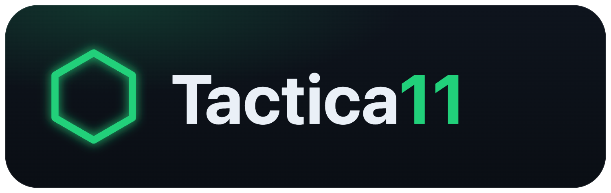
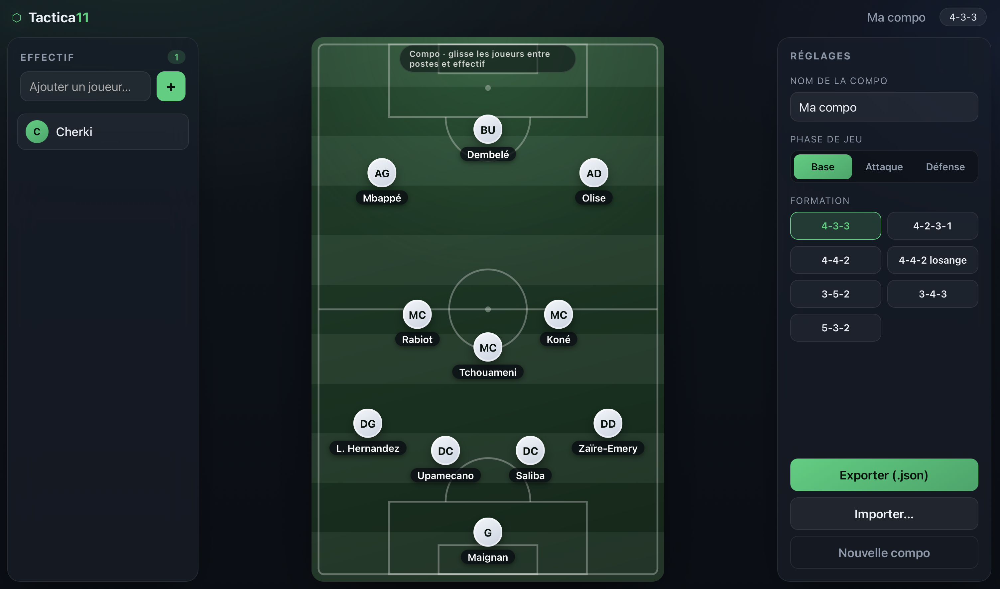

# Tactica11



App web pour créer des **compos et mises en place tactiques de football** :
formation, placement libre des joueurs, variantes par **phase de jeu**
(base / attaque / défense), zones d'influence, adversaires, phases arrêtées,
**séquences animées exportables en vidéo**, le tout partageable par lien ou
exportable.

100 % côté navigateur — **aucun backend**, aucune synchro en ligne. Utilisable sur
iPad et ordinateur, installable comme une app (PWA).

## 🔗 En ligne

Le repo étant privé, GitHub Pages (gratuit uniquement sur repo public) n'est
plus utilisable. L'app est prévue pour être déployée sur un hébergeur
statique gratuit compatible repo privé — **Netlify** (config prête, voir
`netlify.toml`), Vercel ou Cloudflare Pages. Il suffit de connecter le repo
GitHub sur l'un de ces services (build : `npm run build`, dossier : `dist`)
pour retrouver le déploiement automatique à chaque `push` sur `main`.

## Installer en PWA

Une fois l'app ouverte (via l'hébergeur choisi, ou en local avec
`npm run build && npm run preview`), elle s'installe comme une vraie
application, avec icône et fenêtre dédiée, sans passer par un app store :

- **Safari (macOS)** : menu **Fichier → Ajouter au Dock**.
- **Chrome / Edge** : icône d'installation ⊕ dans la barre d'adresse, ou
  menu **⋮ → Installer Tactica11…**.
- **iPad / iPhone (Safari)** : bouton **Partager → Sur l'écran d'accueil**.

Fonctionne ensuite hors-ligne, tout est stocké localement sur l'appareil.

> ⚠️ Une install faite depuis `http://localhost:...` reste rattachée à ce
> serveur local et ne survit pas à son arrêt définitif. Pour une install
> permanente, installe depuis une URL d'hébergeur stable (Netlify, etc.),
> pas depuis `npm run preview`.

## App macOS (Apple Silicon)

À chaque release GitHub, un `.dmg` pour Mac Apple Silicon (macOS 13.3 ou plus
récent) est attaché à la release (workflow `release-macos.yml`, app
[Tauri](https://tauri.app) qui embarque exactement la même app web). Les
exports (PNG, vidéo, projet) y passent par une fenêtre « Enregistrer sous ».

L'app n'est pas signée par Apple : au premier lancement macOS peut la dire
« endommagée » ou d'un « développeur non identifié ». Après l'avoir glissée
dans Applications :

```bash
xattr -cr /Applications/Tactica11.app
```

(ou clic droit sur l'app → **Ouvrir** → **Ouvrir**). Sur Linux et Windows,
utilise la version web / PWA.

## Capture d'écran



## Fonctionnalités

- **Formations** prêtes à l'emploi : 4-3-3 (et faux 9), 4-2-3-1, 4-4-2,
  4-4-2 losange, 3-5-2, 3-4-3, 3-4-2-1, 4-5-1, 5-3-2, 5-2-3, 5-4-1.
- **Phases de jeu** : base, **attaque** et **défense**, chaque emplacement
  gardant ses propres positions par phase + un **slider** pour scruber la
  transition défense ↔ attaque.
- **Placement libre** des joueurs sur le terrain, animé au ressort (Framer Motion),
  avec création d'un joueur directement depuis un emplacement vide en mode base.
- **Effectif en glisser-déposer** : vivier de joueurs, titulaires + remplaçants
  par poste, numéros de maillot optionnels, table triable et éditable en un clic.
- **Zones d'influence** par joueur ou par équipe, avec presets de rôles
  (type EA FC) ajustables à la main.
- **Adversaires** : place les 11 disques adverses en attaque/défense, avec
  sélecteur de couleur.
- **Phase arrêtée** : onglet dédié pour corners, coups francs, touches et
  penaltys, avec état avant/après, transition intermédiaire scrubable et
  calque de dessin (flèches, passes, main levée, zones).
- **Séquence** : raconte une action en plusieurs étapes animées.
  - Deux équipes, ballon et passes (le ballon suit son porteur), disques
    nommés d'après la compo (poste, numéro ou rien) et taille réglable.
  - Flèches typées (passe, course, conduite, appel, pressing) droites ou
    courbes, qui se dessinent à l'écran ; zones et espaces en rectangle (en
    glissant) ou forme libre, aplat ou hachures ; zones et lignes liées aux
    joueurs, marquages, cercles, textes.
  - Traînées de mouvement et micro-mouvements « joueurs vivants », activables
    par joueur ; fantômes, mise en avant, effets, caméra par étape.
  - Timeline avec transition et maintien par étape (0 s possible), lecture,
    navigation ‹ › entre étapes, grille positionnelle.
  - Aperçu plein écran et **export vidéo MP4** (9:16, 16:9 ou 1:1, portrait
    ou paysage) avec titre, chapitres et sous-titres karaoké, pour TikTok,
    Reels et YouTube, ou export PNG de l'instant affiché.
  - Barre d'outils dans la barre du haut, qui se compacte en menus quand la
    fenêtre est étroite.
- **Studio** : génère un visuel de compo façon poster (fond 2D/3D, disques ou
  maillots, portrait/paysage) à exporter en image pour les réseaux sociaux.
- **Grille positionnelle** en surimpression.
- **Thème clair / sombre** avec bascule dans la barre du haut.
- **Mode présentation plein écran** avec tiroir d'outils repliable.
- **Orientation** portrait / paysage du terrain.
- **Annuler / rétablir** (boutons + `⌘/Ctrl + Z`, `⇧` pour rétablir).
- **Plusieurs compos** sauvegardées en local (`localStorage`).
- **Partage & export** : lien partageable (URL compressée), export / import
  `.json`, export du terrain en **image PNG**, import de joueurs depuis un
  fichier **CSV** (détection automatique de l'en-tête et des colonnes,
  colonnes additionnelles importées comme attributs).
- **PWA** installable, utilisable hors-ligne.

## Lancer en développement

```bash
npm install      # une seule fois
npm run dev      # serveur local → http://localhost:5173
```

## Construire la version finale

```bash
npm run build    # génère le dossier dist/ (à héberger n'importe où)
npm run preview  # prévisualiser le build
npm run lint     # oxlint
npm test         # tests du moteur de séquence (vitest)
```

Pour l'app macOS (nécessite Rust et un Mac) :

```bash
npm run app:dev    # fenêtre Tauri branchée sur le serveur de dev
npm run app:build  # génère le .dmg dans src-tauri/target/release/bundle/dmg/
```

> ⚠️ La base est `/` partout (dev, `preview`, Netlify/Vercel/Cloudflare Pages),
> sauf sur GitHub Pages (`/Tactica11/`) où le workflow CI passe
> `DEPLOY_TARGET=gh-pages` au build — voir `vite.config.ts`.

## Stack

- **React 19 + TypeScript** (Vite)
- **Framer Motion** pour les animations (positionnement libre au ressort,
  transitions attaque ↔ défense, bascule de formation)
- **lz-string** (liens partageables compressés), **html-to-image** (export PNG),
  **papaparse** (import CSV)
- **vite-plugin-pwa** (mode hors-ligne / installation)
- **mediabunny** (export vidéo MP4), **Tauri 2** (app macOS)
- Stockage local (`localStorage`) + **export / import `.json`**

## Modèle de données

Une compo = un nom, une formation, une liste de joueurs et 11 emplacements.
Chaque emplacement garde **un jeu de positions par phase** (base, attaque,
défense) et une zone d'influence optionnelle, que l'on peut ajuster librement.
S'y ajoutent les adversaires, les dessins par phase, la couleur adverse, les
situations de phase arrêtée et les réglages du Studio (poster).
Voir `src/types.ts` et `src/formations.ts`.

Le mode Séquence vit dans `src/sequence/` : modèle (`types.ts`), moteur pur
qui calcule l'état du terrain à un instant t (`engine.ts`, testé), rendu SVG
unique pour l'éditeur, l'aperçu et l'export (`SequenceStage.tsx`) et export
vidéo (`exportVideo.ts`). L'interface est dans `src/components/sequence/`.
